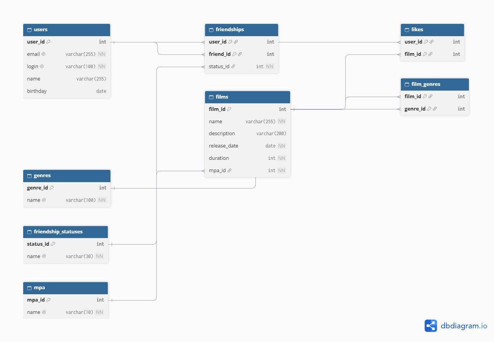

# Filmorate

Backend-сервис для работы с фильмами и пользователями.

## Схема базы данных



### Пояснение к схеме

Схема базы данных включает в себя следующие основные таблицы:

- **users** — хранит данные пользователей: электронную почту, логин, имя и дату рождения.
- **films** — хранит данные о фильмах: название, описание, дату релиза, продолжительность и ссылку на рейтинг MPA.
- **mpa** — справочник возрастных рейтингов.
- **genres** — справочник жанров фильмов.
- **film_genres** — таблица связи «многие-ко-многим» между фильмами и жанрами.
- **likes** — таблица связи «многие-ко-многим», которая хранит информацию о лайках пользователей фильмам.
- **friendships** — таблица связей между пользователями, содержащая информацию о дружбе.
- **friendship_statuses** — справочник статусов дружбы.

## Примеры SQL-запросов

### Пользователи

**Создание пользователя:**

```sql
INSERT INTO users (email, login, name, birthday)
VALUES ('user@mail.com', 'login', 'Name', '1990-01-01');
```

**Получение пользователя по ID:**

```sql
SELECT *
FROM users
WHERE user_id = 1;
```

**Получение всех пользователей:**

```sql
SELECT *
FROM users;
```

### Фильмы

**Добавление фильма:**

```sql
INSERT INTO films (name, description, release_date, duration, mpa_id)
VALUES ('Интерстеллар', 'Фантастический фильм', '2014-11-07', 169, 3);
```

**Получение фильма по ID вместе с рейтингом MPA:**

```sql
SELECT f.*, m.name AS mpa_name
FROM films f
JOIN mpa m ON f.mpa_id = m.mpa_id
WHERE f.film_id = 1;
```

**Получение фильма вместе с его жанрами:**

```sql
SELECT f.film_id, f.name, g.genre_id, g.name AS genre_name
FROM films f
LEFT JOIN film_genres fg ON f.film_id = fg.film_id
LEFT JOIN genres g ON fg.genre_id = g.genre_id
WHERE f.film_id = 1;
```

### Жанры и рейтинги MPA

**Получение списка всех жанров:**

```sql
SELECT *
FROM genres;
```

**Получение списка возрастных рейтингов:**

```sql
SELECT *
FROM mpa;
```

### Лайки

**Добавление лайка пользователя фильму:**

```sql
INSERT INTO likes (user_id, film_id)
VALUES (1, 1);
```

**Получение популярных фильмов по количеству лайков:**

```sql
SELECT f.*, COUNT(l.user_id) AS likes_count
FROM films f
LEFT JOIN likes l ON f.film_id = l.film_id
GROUP BY f.film_id
ORDER BY likes_count DESC;
```

### Друзья

**Добавление пользователя в друзья:**

```sql
INSERT INTO friendships (user_id, friend_id, status_id)
VALUES (1, 2, 1);
```

**Получение списка друзей пользователя:**

```sql
SELECT u.*
FROM friendships fr
JOIN users u ON fr.friend_id = u.user_id
WHERE fr.user_id = 1;
```

**Получение общих друзей двух пользователей:**

```sql
SELECT u.*
FROM friendships f1
JOIN friendships f2 ON f1.friend_id = f2.friend_id
JOIN users u ON f1.friend_id = u.user_id
WHERE f1.user_id = 1
  AND f2.user_id = 2;
```

## Связи между таблицами

- Один пользователь может поставить лайки многим фильмам.
- Один фильм может получить лайки от многих пользователей.
- Один фильм может относиться к нескольким жанрам.
- Один жанр может использоваться в нескольких фильмах.
- Каждый фильм связан с одним рейтингом MPA.
- Пользователь может иметь связи с другими пользователями через таблицу `friendships`.
- Одна запись справочника `friendship_statuses` может использоваться в нескольких записях таблицы `friendships`.
